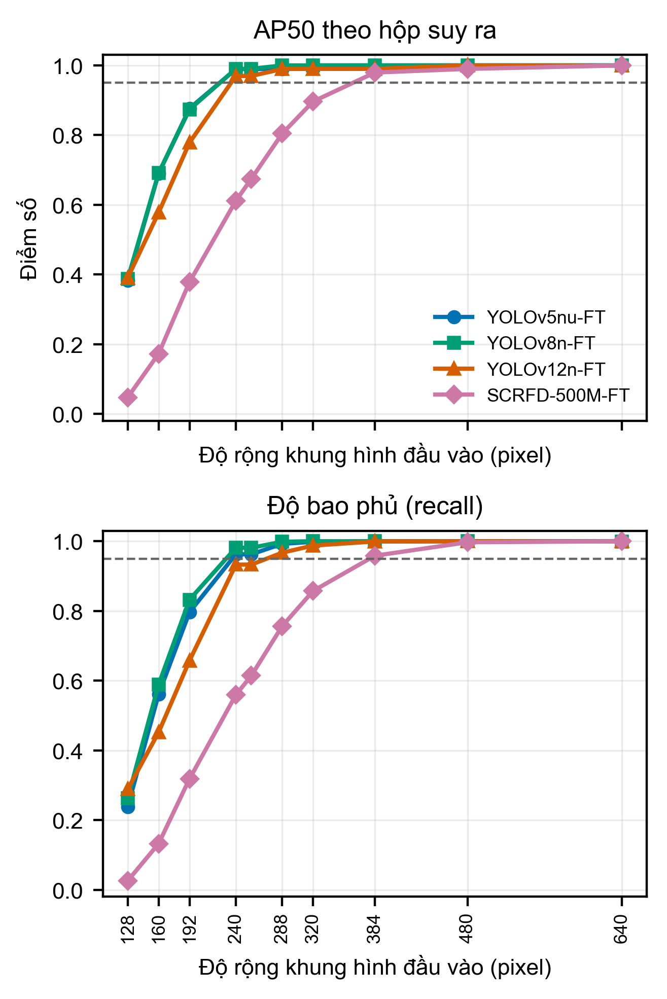
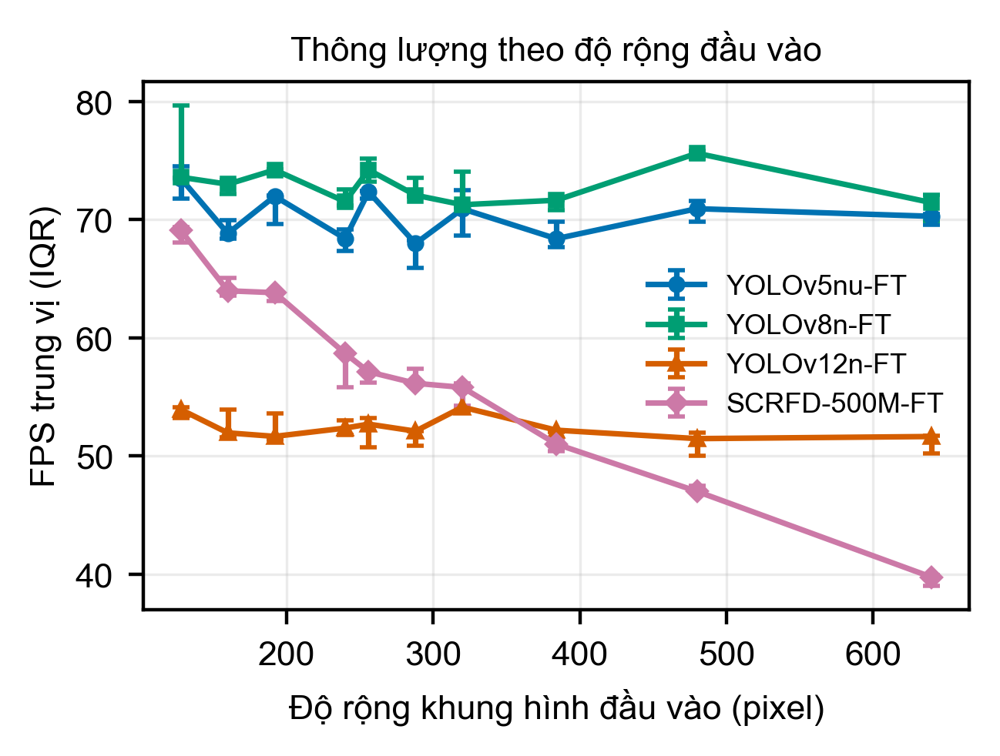
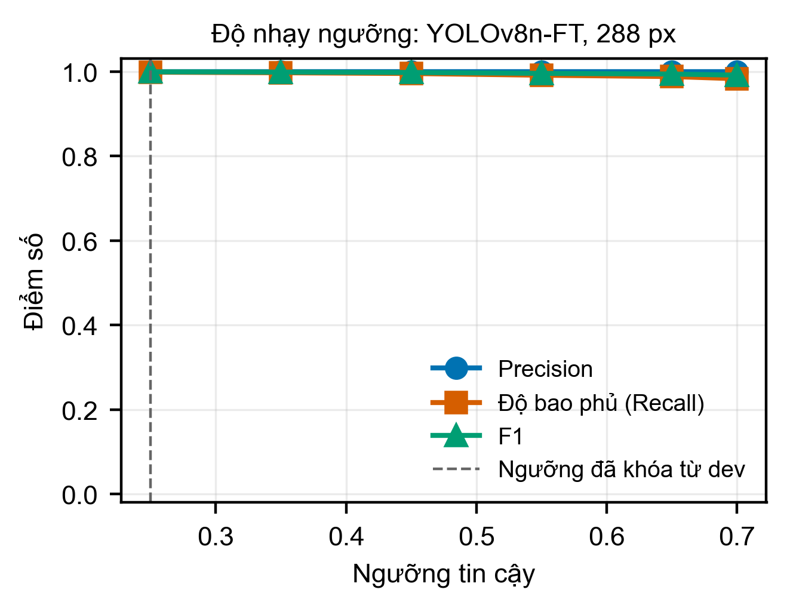

# Phát hiện khuôn mặt ở độ phân giải tối thiểu cho giám sát thời gian thực: benchmark YOLO và SCRFD

**Vu Hai Minh** — Khoa Trí tuệ Nhân tạo, Đại học FPT, Hà Nội, Việt Nam — vhaiminh.2k5@gmail.com  
**Cao Van Mai** — Khoa Trí tuệ Nhân tạo, Đại học FPT, Hà Nội, Việt Nam — maicv2@fe.edu.vn

> Thông tin tác giả được chép nguyên trạng từ DOCX hiện tại. Hãy đồng bộ nếu bạn sửa thông tin trong DOCX.

## Tóm tắt

Nghiên cứu này đo lường sự đánh đổi giữa độ phân giải đầu vào, độ chính xác phát hiện và thông lượng ở cấp độ bộ phát hiện trên video ChokePoint Portal 1, cảnh chính diện trong nhà. Chúng tôi chia dữ liệu theo toàn bộ chuỗi, gồm 4.900 khung hình huấn luyện, 1.135 khung hình phát triển và 5.676 khung hình kiểm thử được giữ riêng; sau đó so sánh các mô hình YOLOv5nu, YOLOv8n, YOLOv12n và SCRFD-500M đã tinh chỉnh. Phép đánh giá quét mười độ rộng đầu vào từ 640 đến 128 pixel và sáu ngưỡng tin cậy; việc chọn điểm vận hành chỉ dùng tập phát triển. Quy tắc dựa trên tập phát triển chọn YOLOv8n-FT ở độ rộng 288 pixel. Trên tập kiểm thử đã khóa, cấu hình này đạt AP50 1,000, recall 0,998 và thông lượng trung vị 72,1 khung hình/giây theo hộp suy ra từ mốc mắt. Trên 240 hộp vẽ tay, cùng cấu hình đạt AP50 1,000 và recall 0,996. Các hộp vẽ tay trùng hoàn toàn với hộp suy ra trong mẫu này (IoU=1,000), nên phép kiểm toán không tạo ra phép đo độc lập về sai lệch nhãn. Nghiên cứu không đo độ chính xác nhận dạng danh tính hay hiệu năng toàn pipeline.

**Từ khóa—** phát hiện khuôn mặt, giám sát video, ChokePoint, giảm độ phân giải, thông lượng, YOLO, SCRFD.

## I. Giới thiệu

Hệ thống giám sát video thường đặt bộ phát hiện trước các bước căn chỉnh khuôn mặt và nhận dạng danh tính. Giảm độ phân giải khung hình là một cách có thể kiểm soát để giảm khối lượng xử lý đầu vào của bộ phát hiện, nhưng khuôn mặt nhỏ hơn có thể khó định vị hơn. Bài báo này chỉ đo lường sự đánh đổi đó đối với phát hiện khuôn mặt. Nghiên cứu không kiểm tra nhận dạng danh tính, tải cảnh đông người hay toàn bộ pipeline giám sát.

Đóng góp của nghiên cứu là một benchmark có thể tái lập về độ phân giải cho các chuỗi ChokePoint Portal 1, cảnh chính diện trong nhà. Benchmark dùng các tập huấn luyện, phát triển và kiểm thử tách biệt theo chuỗi; hộp đại diện chung suy ra từ mốc mắt; các bộ phát hiện YOLO và SCRFD đã tinh chỉnh; phép quét độ rộng và ngưỡng tin cậy; cùng phép đo thông lượng đồng bộ trên một GPU laptop. Đây là phép so sánh thực nghiệm theo giao thức đã nêu, không phải một bộ phát hiện mới hay khẳng định tổng quát về một họ mô hình.

## II. Phương pháp

### A. Công trình liên quan

YOLO đưa ra cách tiếp cận phát hiện đối tượng một giai đoạn cho thời gian thực [1]. Nghiên cứu này dùng các triển khai Ultralytics và checkpoint nano được công bố; khởi tạo YOLOv5 là checkpoint YOLOv5nu với head được cập nhật, theo cách phân biệt trong tài liệu mô hình hiện hành [5]; YOLOv12 là bộ phát hiện tập trung vào attention [6]. SCRFD phân bổ lại mẫu và tính toán nhằm phát hiện khuôn mặt hiệu quả [4]. ChokePoint được thu thập cho phân tích khuôn mặt qua video tại lối vào và cung cấp các chuỗi giám sát toàn khung hình cùng mốc mắt [2], [3].

### B. Tập dữ liệu và cách chia

Nguồn dữ liệu là tập con toàn khung hình ChokePoint Portal 1, cảnh chính diện trong nhà. Việc chia dữ liệu gom theo toàn bộ chuỗi nguồn thay vì lấy khung hình ngẫu nhiên: ba chuỗi cho huấn luyện, một chuỗi cho phát triển và bốn chuỗi cho tập kiểm thử đã khóa. Không có chuỗi, cặp dữ liệu/khung hình hay cặp khung hình liền kề nào bị chia cắt qua các tập. Phiên S2 và camera C2 xuất hiện ở cả chuỗi huấn luyện lẫn phát triển; camera C1 xuất hiện ở chuỗi huấn luyện và kiểm thử. Các metadata này có giao nhau nhưng không khiến một chuỗi nguồn hay khung hình xuất hiện ở nhiều tập. Cách chia này không khẳng định các chủ thể có danh tính tách biệt giữa các tập.

**Bảng I. Phân hoạch dữ liệu theo chuỗi.**

| Tập | Chuỗi | Số khung hình |
|---|---|---:|
| Huấn luyện | P1E_S1_C1 | 1.382 |
| Huấn luyện | P1L_S1_C1 | 1.799 |
| Huấn luyện | P1L_S2_C2 | 1.719 |
| Phát triển | P1E_S2_C2 | 1.135 |
| Kiểm thử | P1E_S3_C3 | 929 |
| Kiểm thử | P1E_S4_C1 | 1.531 |
| Kiểm thử | P1L_S3_C3 | 1.205 |
| Kiểm thử | P1L_S4_C1 | 2.011 |

Tổng cộng có 4.900 khung hình huấn luyện, 1.135 khung hình phát triển và 5.676 khung hình kiểm thử. Tập kiểm thử không được dùng để khớp mô hình, chọn checkpoint hay chọn điểm vận hành. Các con số này là số mẫu toàn khung hình có nhãn trong manifest đã tạo; chúng không đại diện cho mọi khung hình hay mọi danh tính trong bộ ChokePoint.

### C. Hộp suy ra từ mốc mắt

ChokePoint cung cấp mốc mắt được gán nhãn thủ công thay vì hình chữ nhật cho bộ phát hiện. Với khoảng cách giữa hai mắt là *d* và trung điểm hai mắt là (*cx*, *cy*), hộp đại diện được tính như sau: x1=cx−1,4d; x2=cx+1,4d; y1=cy−1,2d; y2=cy+2,4d. Tọa độ được cắt theo biên khung hình 800×600. Các hộp xác định bằng công thức này là nhãn đại diện, tách biệt với hộp vẽ tay.

Tác giả vẽ một hộp khuôn mặt cho mỗi 240 khung hình test, phân tầng theo bốn chuỗi và ba nhóm khoảng cách giữa hai mắt. Các hộp này được giữ riêng và dùng cho một phép kiểm toán thứ cấp; chúng không tham gia chọn mô hình hay điểm vận hành. Không có người gán nhãn thứ hai hoặc bước phân xử được ghi nhận.

### D. Bộ phát hiện và tinh chỉnh

Các mô hình được so sánh gồm YOLOv5nu, YOLOv8n và YOLOv12n khởi tạo từ trọng số nano Ultralytics cục bộ, cùng bộ phát hiện khuôn mặt SCRFD-500M khởi tạo từ checkpoint trong model zoo chính thức của InsightFace [4]. Mỗi mô hình được tinh chỉnh trên cùng 4.900 mẫu huấn luyện và chọn checkpoint bằng cùng 1.135 mẫu phát triển. YOLO được huấn luyện 20 epoch, ảnh 640 pixel, batch size 8, seed 391 và các mặc định Ultralytics 8.4.54 đã ghi nhận, với cơ chế tự chọn optimizer. SCRFD được huấn luyện 20 epoch, batch size 2, seed 391 theo công thức huấn luyện MMDetection với SGD và learning rate 0,0025. Chi tiết công thức khác nhau theo framework và được ghi trong artifact chạy; phép so sánh kiểm soát cách chia dữ liệu chứ không đồng nhất mọi tham số optimizer hay augmentation.

Mã SCRFD được cố định tại commit InsightFace c6c3af7 và dùng bản vá tương thích Windows đã ghi nhận cho MMCV 1.7.2 cùng gói pycocotools cài trên Windows. Trọng số InsightFace tiền huấn luyện được phân phối cho nghiên cứu phi thương mại; nghiên cứu này không hàm ý quyền sử dụng thương mại.

### E. Chỉ số và giao thức đo

Tỷ lệ khung hình gốc được giữ nguyên tại các độ rộng 640, 480, 384, 320, 288, 256, 240, 192, 160 và 128 pixel. Các ngưỡng tin cậy là 0,25; 0,35; 0,45; 0,55; 0,65 và 0,70; ngưỡng IoU ghép cặp là 0,50. AP50 được tính từ các phát hiện có confidence tối thiểu 0,001 bằng precision nội suy 101 điểm. Ở mỗi ngưỡng được liệt kê, một dự đoán được ghép với một hộp đại diện chưa ghép trong cùng khung hình; các phát hiện còn lại và hộp bị bỏ sót lần lượt đóng góp vào FP và FN. Quy tắc đã định trước trên tập phát triển yêu cầu AP50 và recall đều ít nhất 0,95 ở confidence 0,25. Quy tắc chọn độ rộng nhỏ nhất thỏa cả hai điều kiện; khi hòa, ưu tiên AP50 phát triển cao hơn, sau đó recall cao hơn, rồi thứ tự mô hình cố định. Kết quả test không làm thay đổi mô hình, độ rộng hay ngưỡng đã chọn.

Thông lượng được đo trên mẫu cố định 600 khung hình, gồm 150 khung hình từ mỗi chuỗi kiểm thử, với 50 lượt khởi động và năm lượt đo đầy đủ. GPU được đồng bộ quanh mỗi lượt đo. Vùng tính thời gian gồm đọc ảnh, resize/tiền xử lý của framework, suy luận detector và hậu xử lý của mô hình; không tính thời gian nạp mô hình và tính metric. Báo cáo FPS trung vị và khoảng tứ phân vị. Đây là thông lượng detector trên GPU laptop NVIDIA GeForce RTX 3050 với bộ nhớ 4 GB, không phải độ trễ nhận dạng đầu cuối.

## III. Kết quả

### A. Mốc tham chiếu ở độ phân giải gốc

**Bảng II. Kết quả kiểm thử ở độ rộng 640 pixel và confidence 0,25.**

| Mô hình | AP50 | Recall | FPS |
|---|---:|---:|---:|
| YOLOv5nu-FT | 1,000 | 1,000 | 70,3 |
| YOLOv8n-FT | 1,000 | 0,999 | 71,4 |
| YOLOv12n-FT | 1,000 | 1,000 | 51,7 |
| SCRFD-500M-FT | 1,000 | 1,000 | 39,7 |

Bảng II là mốc tham chiếu mô tả trên tập kiểm thử đã khóa. Bảng không quyết định mô hình hay ngưỡng được đề xuất. AP50 tính trên phát hiện có confidence từ 0,001; precision, recall và F1 dùng confidence 0,25. Các chỉ số đều so với hộp đại diện suy ra từ mốc mắt.

### B. Đánh đổi giữa độ phân giải và ngưỡng tin cậy

Chỉ dùng dữ liệu phát triển, quy tắc đã định trước khóa cấu hình YOLOv8n-FT ở 288×216 pixel và confidence 0,25. Kết quả test của cấu hình này là AP50 1,000, precision 1,000, recall 0,998, F1 0,999 và thông lượng trung vị 72,1 FPS (IQR 72,0–73,5). Đây là ước lượng trên test cho một cấu hình đã khóa từ trước, không phải điểm vận hành được chọn dựa trên test.

Hình 1 cho thấy AP50 và recall theo độ rộng ở confidence 0,25. Hình 2 báo cáo thông lượng ở từng độ phân giải trên cùng mẫu đo tốc độ cố định. Hình 3 thể hiện precision, recall và F1 theo ngưỡng tin cậy cho cấu hình được khóa từ tập phát triển. Các đường này hỗ trợ phân tích đánh đổi theo giao thức cụ thể; chúng không chứng minh một kiến trúc nói chung vượt trội hơn.

**Bảng III. Kết quả trên 240 hộp vẽ tay ở độ rộng 288 pixel. AP50 dùng confidence tối thiểu 0,001; precision, recall và F1 dùng confidence 0,25.**

| Mô hình | AP50 | Precision | Recall | F1 |
|---|---:|---:|---:|---:|
| YOLOv5nu-FT | 1,000 | 1,000 | 0,983 | 0,992 |
| YOLOv8n-FT | 1,000 | 1,000 | 0,996 | 0,998 |
| YOLOv12n-FT | 0,980 | 1,000 | 0,958 | 0,979 |
| SCRFD-500M-FT | 0,861 | 0,965 | 0,808 | 0,880 |

Trong cả 240 ảnh, IoU giữa hộp vẽ tay và hộp suy ra từ mốc mắt bằng 1,000 (IQR 1,000–1,000). Vì hai tập hộp trùng tọa độ trong mẫu này, phép kiểm toán không cung cấp đánh giá độc lập về độ lệch của nhãn đại diện. AP50 dùng confidence tối thiểu 0,001; precision, recall và F1 dùng confidence 0,25.

## IV. Thảo luận và kết luận

### A. Diễn giải

Độ phân giải làm thay đổi cả chất lượng phát hiện lẫn khối lượng xử lý của detector trong điều kiện biến đổi ảnh và phần cứng đã nêu. Kết quả được khóa từ tập phát triển cung cấp một điểm vận hành có thể tái lập khi thỏa các ràng buộc AP50 và recall đã đặt trước. Toàn bộ sweep test dựa trên hộp suy ra; phép kiểm toán 240 hộp vẽ tay cho kết quả tương tự nhưng các tọa độ trùng hoàn toàn với hộp đại diện. Các kết quả cần được diễn giải trong bối cảnh nhãn, công thức huấn luyện riêng của từng mô hình và GPU đã đo. AP50 gần 1 không có nghĩa phát hiện khuôn mặt hay nhận dạng hoàn hảo.

### B. Hạn chế và hướng nghiên cứu tiếp

Sweep độ phân giải chính dùng hộp suy ra từ mốc mắt; kiểm toán hộp vẽ tay chỉ gồm 240 khung hình do một người gán nhãn, không có độ nhất trí liên gán nhãn hay phân xử. Các hộp thủ công trùng tọa độ với hộp suy ra trong mẫu này, nên chưa thể xem đây là xác thực độc lập. Thí nghiệm chỉ bao phủ các chuỗi cảnh chính diện trong nhà tại Portal 1 và một GPU laptop RTX 3050; kết quả không xác lập khả năng khái quát sang cổng khác, ngoài trời, tình huống che khuất, danh tính tách biệt hay phần cứng khác. Nghiên cứu không đo độ chính xác nhận dạng phía sau, tải khi có nhiều khuôn mặt hay độ trễ toàn pipeline. Công việc tiếp theo cần gán nhãn độc lập và phân xử, đánh giá thêm cổng và phần cứng, đồng thời đo toàn bộ pipeline từ phát hiện đến nhận dạng.

### C. Kết luận

Nghiên cứu xây dựng một benchmark chia theo chuỗi về phát hiện khuôn mặt phụ thuộc độ phân giải trên video ChokePoint Portal 1, cảnh chính diện trong nhà, và so sánh các mô hình YOLO với SCRFD đã tinh chỉnh trên cùng các mẫu huấn luyện, phát triển và kiểm thử. Quy tắc chỉ dùng tập phát triển khóa cấu hình trước khi đánh giá test; một mẫu cố định riêng được dùng để đo thông lượng detector. Kết luận chỉ áp dụng cho nhãn hộp suy ra, các chuỗi đã liệt kê và GPU đã thử nghiệm; hiệu năng nhận dạng và độ an toàn khi triển khai cần được đánh giá riêng.

## Tài liệu tham khảo

[1] J. Redmon, S. Divvala, R. Girshick, and A. Farhadi, “You Only Look Once: Unified, real-time object detection,” in Proc. IEEE Conf. Computer Vision and Pattern Recognition, 2016, pp. 779–788, doi: 10.1109/CVPR.2016.91.

[2] Y. Wong, S. Chen, S. Mau, C. Sanderson, and B. C. Lovell, “Patch-based probabilistic image quality assessment for face selection and improved video-based face recognition,” in Proc. IEEE CVPR Workshops, 2011, pp. 81–88, doi: 10.1109/CVPRW.2011.5981881.

[3] Y. Wong, S. Chen, S. Mau, C. Sanderson, and B. C. Lovell, “ChokePoint Dataset,” Zenodo, version 1, Jun. 22, 2017, doi: 10.5281/zenodo.815657.

[4] J. Guo, J. Deng, A. Lattas, and S. Zafeiriou, “Sample and computation redistribution for efficient face detection,” in Proc. Int. Conf. Learning Representations, 2022. [Online]. Available: https://arxiv.org/abs/2105.04714.

[5] Ultralytics, “Models supported by Ultralytics,” 2026. [Online]. Available: https://docs.ultralytics.com/models. Accessed: Nov. 14, 2026.

[6] Y. Tian, Q. Ye, and D. Doermann, “YOLOv12: Attention-centric real-time object detectors,” in Advances in Neural Information Processing Systems, vol. 38, 2025, doi: 10.52202/085713-2627.
