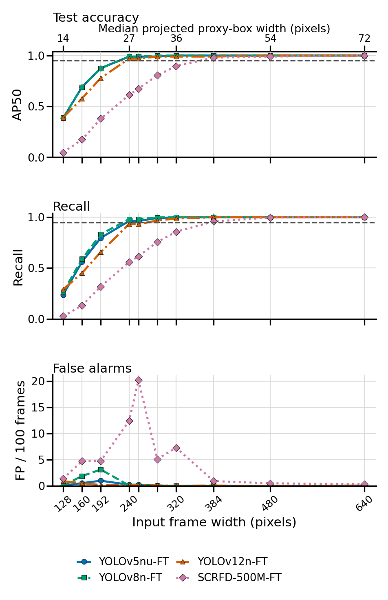
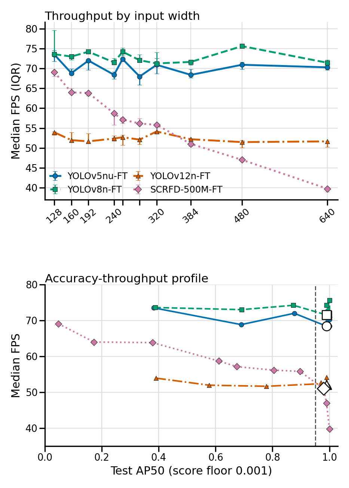
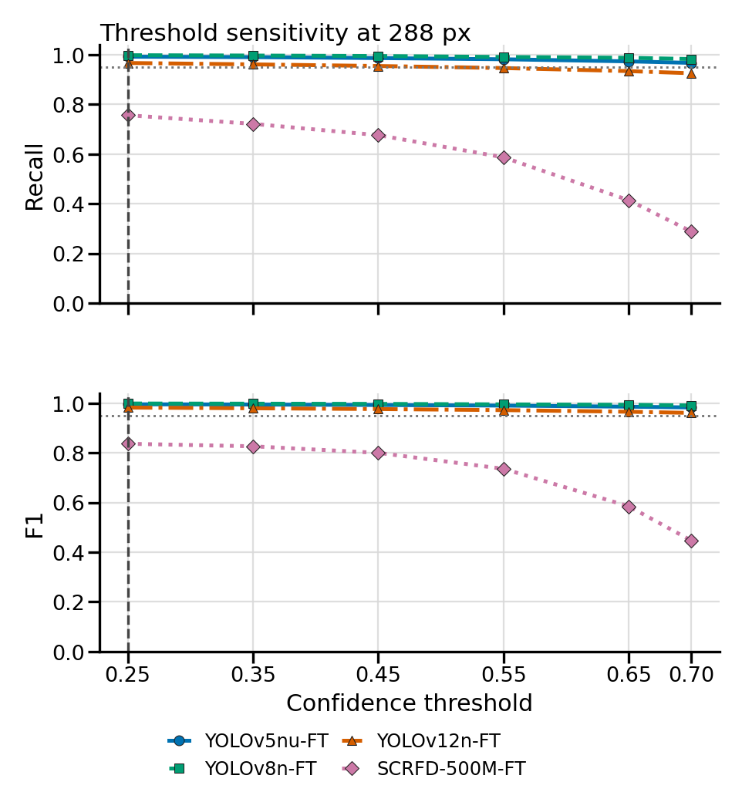
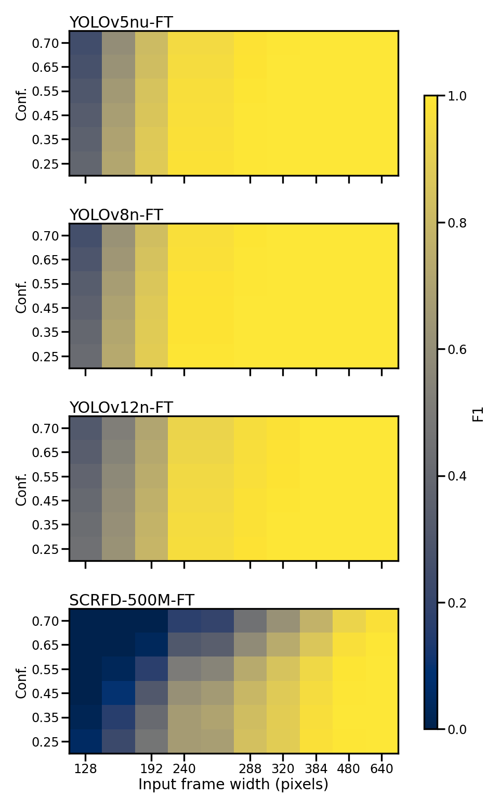

# Minimum-Resolution Face Detection for Real-Time Surveillance: A Benchmark of YOLO and SCRFD

| Vu Hai Minh / Department of Artificial Intelligence / FPT University / Ha Noi, Viet Nam / vhaiminh.2k5@gmail.com | Cao Van Mai / Department of Artificial Intelligence / FPT University / Ha Noi, Viet Nam / maicv2@fe.edu.vn |
| --- | --- |

Abstract—This study provides a deployment-oriented benchmark for selecting face-detector input resolution under an explicit accuracy and throughput budget. Four fine-tuned models (YOLOv5nu, YOLOv8n, YOLOv12n, and SCRFD-500M) are evaluated on sequence-disjoint ChokePoint Portal 1 indoor frontal video: 4,900 training, 1,135 development, and 5,676 test frames. The test sweep covers ten input widths (640–128 pixels) and six confidence thresholds. A development-only rule selected YOLOv8n-FT at 288 pixels; on the locked test set it reached AP50 1.000, recall 0.998, and median detector throughput 72.1 frames/s on an NVIDIA GeForce RTX 3050 Laptop GPU. At the preset AP50 and recall gate of 0.95, the smallest widths observed in the test sweep were 240 pixels for YOLOv5nu-FT and YOLOv8n-FT, 288 for YOLOv12n-FT, and 384 for SCRFD-500M-FT. These profiles show where resolution reduction preserves proxy-label agreement and where its speed benefit is model-dependent. The benchmark supports model and resolution shortlisting for this surveillance setting; its labels are eye-landmark-derived boxes, and it does not measure recognition accuracy or cross-hardware performance.

Index Terms—face detection, surveillance video, resolution scaling, throughput, operating point, YOLO, SCRFD.

## I. INTRODUCTION

Surveillance pipelines often process every frame through detection before face alignment and identity recognition. Input downscaling can reduce the detector workload, but it also removes spatial detail from already small faces. For deployment, the useful question is therefore not which detector has the highest score at one resolution, but which model, resolution, and confidence setting meets a stated detection-quality requirement within the available processing budget.

This paper provides a practical reference for that decision on ChokePoint Portal 1 indoor frontal video. Four face detectors are fine-tuned on the same sequence-level split and measured across ten input widths and six confidence thresholds. We report detection quality and synchronized throughput together, include a development-locked operating point, and summarize the lowest test-sweep widths that meet the study's preset AP50 and recall gate. The resulting profiles help practitioners shortlist configurations by accuracy and frame-rate priorities. Throughput is measured on one specified laptop GPU; the scores use transparent eye-landmark-derived proxy boxes.

The motivating deployment problem has two coupled costs. A missed face cannot be cropped for alignment or sent to identity recognition, while a false detection can consume downstream compute on an invalid crop. Input width and confidence therefore affect both the quality of face localization and the number of crops produced. This benchmark quantifies detector-level accuracy and throughput so a project can make an initial choice against its miss tolerance and frame-rate target; it does not claim that the selected detector alone determines end-to-end recognition performance.

## II. RELATED WORK

Real-time face detection has long balanced localization quality against computation. Viola and Jones used a cascade to reject most image windows quickly [1]; modern single-stage detectors such as YOLO formulate localization and classification in one forward pass [3]. The YOLOv5 and YOLOv8 checkpoints used here are documented Ultralytics implementations [6], [7], [10], while YOLOv12 adopts an attention-centric design [8]. Comparing these model families across input widths makes the speed–quality trade-off visible under a shared deployment protocol.

Face analysis becomes especially sensitive to spatial detail when the face occupies only a small part of a surveillance frame. Prior low-resolution face research documents this challenge in non-ideal imagery [2]. SCRFD provides a face-specific alternative designed to redistribute samples and computation for an efficiency–accuracy trade-off [9]. In this study, SCRFD is fine-tuned on the same ChokePoint training and development partitions as the YOLO models. The comparison therefore describes the measured, adapted detector profiles; it should not be interpreted as an architecture-only ranking across original pretrained checkpoints.

ChokePoint supplies portal-camera sequences and manually annotated eye landmarks rather than native face rectangles [4], [5]. The present work uses full frames and a fixed landmark-to-box construction to create a reproducible detector benchmark, then holds complete sequences out for testing. This protocol focuses the analysis on the practical resolution choice while making the target-box convention explicit.

## III. DATASET AND LABEL PROTOCOL

## A. Dataset and Sequence Split

The source is the full-frame Portal 1 indoor frontal subset of ChokePoint, whose source frames are 800×600 pixels. Complete source sequences, rather than random frames, define the split: three sequences for training, one for development, and four for the locked test set. No sequence, dataset/frame pair, or adjacent-frame pair crosses the split. Session S2 and camera C2 occur in training and development; camera C1 occurs in training and test, while source sequences and frames remain disjoint. The split does not claim identity-disjoint subjects.

TABLE I. Sequence-level data partition.

| Split | Sequence | Frames |
| --- | --- | --- |
| Train | P1E_S1_C1 | 1,382 |
| Train | P1L_S1_C1 | 1,799 |
| Train | P1L_S2_C2 | 1,719 |
| Development | P1E_S2_C2 | 1,135 |
| Test | P1E_S3_C3 | 929 |
| Test | P1E_S4_C1 | 1,531 |
| Test | P1L_S3_C3 | 1,205 |
| Test | P1L_S4_C1 | 2,011 |

The split contains 4,900 training, 1,135 development, and 5,676 test frames (11,711 in total). The development set is used to choose the model and operating width; test data are excluded from fitting, checkpoint selection, and that choice. The test sweep is then reported descriptively across all four models and widths. These counts describe labeled full-frame instances in the derived manifest, not every frame or identity in ChokePoint.

## B. Target Boxes and Annotation Scope

ChokePoint supplies manually labeled eye landmarks, not face rectangles. For inter-eye distance d and eye midpoint (cx, cy), each reference box is defined as x1=cx−1.4d, x2=cx+1.4d, y1=cy−1.2d, and y2=cy+2.4d, then clipped to the 800×600 frame. The same geometric rule is applied throughout training, development, and test. These fixed boxes are proxy labels, not native or manually drawn face boundaries; AP50, precision, recall, and F1 measure agreement with this convention. The rule makes the benchmark reproducible, but results remain sensitive to its box geometry and should not be read as human-annotation accuracy.

A separate user-designated reference file covers 240 test frames, balanced across the four test sequences and three eye-distance strata. It is reported only as a secondary box-agreement comparison and was not used to choose a model, resolution, or threshold.

The 240 reference-box coordinates exactly match the accompanying InsightFace proposal file. Consequently, this subset does not provide independent human-annotation validation of those proposals; no second-annotator agreement or adjudication is available. The paper reports the comparison as a supplementary agreement result and keeps the full-sweep metric definition tied to the eye-landmark-derived proxies. It is not used as a second ground truth or as evidence that the proxy construction is unbiased.

## IV. EXPERIMENTAL SETUP

## A. Detectors and Fine-Tuning

The compared detectors are YOLOv5nu, YOLOv8n, and YOLOv12n initialized from Ultralytics nano weights, and SCRFD-500M initialized from its selected pretrained checkpoint [9]. All four models use the same 4,900 training instances and 1,135 development instances. YOLO models were trained for 20 epochs at 640-pixel width, batch size 8, seed 391, using Ultralytics 8.4.54 and its recorded automatic optimizer selection. SCRFD was trained for 20 epochs, batch size 2, seed 391, with the recorded MMDetection recipe (SGD, learning rate 0.0025). Framework-specific optimizer and augmentation recipes differ; data partitions and selection data are shared.

The SCRFD code revision, Windows compatibility patch, checkpoint hashes, and training provenance are recorded in the run artifacts. The measured environment used PyTorch 2.1.2 with CUDA 12.1, Ultralytics 8.4.54, MMCV 1.7.2, MMDetection 2.7.0, and OpenCV 4.11.0. Framework-native resizing/letterboxing is retained for each detector, with aspect ratio preserved and a common maximum input width.

## B. Metrics and Measurement Protocol

The aspect ratio is preserved at input widths 640, 480, 384, 320, 288, 256, 240, 192, 160, and 128 pixels. Confidence thresholds are 0.25, 0.35, 0.45, 0.55, 0.65, and 0.70; matching and non-maximum suppression use IoU 0.50. AP50 is computed from detections above a 0.001 confidence floor with 101-point interpolated precision. This distinction matters: AP50 summarizes the ranked detections above the score floor, while precision, recall, and F1 at a selected confidence describe one operating point. IoU 0.50 is used because the targets follow a fixed geometric proxy-box convention; stricter overlap thresholds would make the score more sensitive to proxy-box geometry than to detector choice. At each listed confidence threshold, predictions are matched to unmatched proxy boxes within the same frame; unmatched detections and boxes contribute to false positives and false negatives. The predeclared development rule requires AP50≥0.95 and recall≥0.95 at confidence 0.25, then selects the smallest eligible width. Ties are resolved by development AP50, recall, and a fixed model order. Test results do not change that selection.

Throughput uses a fixed sample of 600 test frames (150 per test sequence), 50 warm-up iterations, and five full repeats, with GPU synchronization around each timed repeat. The timed region includes image reading, framework preprocessing and resizing, detector inference, and model postprocessing; model loading and metric computation are excluded. Median frames/s and the interquartile range are reported for an NVIDIA GeForce RTX 3050 Laptop GPU with 4 GB memory. This is detector throughput, not end-to-end recognition latency. The run record does not contain CPU, system RAM, operating-system build, CUDA driver, or CPU-only benchmark results; therefore the FPS values are a reference for this GPU/software path rather than a conversion factor for another machine.

## V. RESULTS

## A. Full-Resolution Reference

TABLE II. Test results at 640-pixel width. AP50 uses score floor 0.001; recall uses confidence 0.25.

| Model | AP50 | Recall | FPS |
| --- | --- | --- | --- |
| YOLOv5nu-FT | 1.000 | 1.000 | 70.3 |
| YOLOv8n-FT | 1.000 | 0.999 | 71.4 |
| YOLOv12n-FT | 1.000 | 1.000 | 51.7 |
| SCRFD-500M-FT | 1.000 | 1.000 | 39.7 |

At 640 pixels all four fine-tuned detectors have AP50 1.000 and recall at or above 0.999 against the proxy boxes. Throughput ranges from 39.7 frames/s for SCRFD-500M-FT to 71.4 frames/s for YOLOv8n-FT. The near-ceiling scores make the full-resolution point a useful reference but do not separate the models; their operating profiles diverge under downscaling.

## B. Resolution, Confidence, and Throughput Profiles

The development-only rule selected YOLOv8n-FT at 288×216 pixels and confidence 0.25 (development AP50 0.9901; recall 0.9630). On the locked test set this configuration reached AP50 1.000, precision 1.000, recall 0.998, F1 0.999, and median throughput 72.1 frames/s (IQR 72.0–73.5). At 30 frames/s per stream, this is 2.4× detector-stage throughput on the measured GPU; at 60 frames/s it is 1.2× before any downstream recognition or multi-stream overhead.

The additional plots combine AP50, recall, and false positives per 100 frames in Fig. 1; its top axis translates input width to the median projected proxy-box width (90.0 pixels at the original 800-pixel frame width). YOLOv5nu-FT and YOLOv8n-FT retain recall above 0.95 through 240 pixels, YOLOv12n-FT through 288 pixels, and SCRFD-500M-FT through 384 pixels. At 320 pixels, SCRFD recall is 0.857 with 7.28 false positives per 100 frames; at 384 pixels it reaches 0.958 recall with 0.92 false positives per 100 frames. Fig. 2 restores the accuracy-throughput view: open markers identify each model's smallest width passing both preset gates. YOLO throughput changes little with downscaling, while SCRFD gains speed as its accuracy falls. Fig. 3 isolates threshold behavior at 288 pixels; Fig. 4 restores the full resolution-by-confidence F1 sensitivity for all four detectors. Together, recall and false positives show the complementary miss and false-alarm behavior across input sizes.

Fig. 1. Test AP50, recall, and false positives per 100 frames by input width. The top axis shows median projected proxy-box width. AP50 uses score floor 0.001; recall and false positives use confidence 0.25. Dashed lines mark the 0.95 AP50 and recall gates. Marker shapes and line patterns distinguish models in grayscale.

Fig. 2. Median detector throughput by input width (IQR over five repeats) and the AP50-throughput profile. Open markers identify the smallest width passing both preset AP50 and recall gates; marker shapes and line patterns distinguish models in grayscale.

Fig. 3. Test recall and F1 across confidence thresholds at 288-pixel width. Marker shapes and line patterns identify detector models; dashed guides mark confidence 0.25 and score 0.95.

Fig. 4. Test F1 across the ten input widths and six confidence thresholds for each fine-tuned detector. Model names label each panel; the sequential luminance scale remains readable in grayscale.

TABLE V. YOLOv8n-FT confidence-threshold sensitivity at 288×216 pixels. AP50 remains 0.999965 (1.000 when rounded); false positives are zero at all six listed thresholds.

| Confidence | Precision | Recall | F1 | False negatives |
| --- | --- | --- | --- | --- |
| 0.25 | 1.000 | 0.998 | 0.999 | 9 |
| 0.35 | 1.000 | 0.997 | 0.999 | 17 |
| 0.45 | 1.000 | 0.995 | 0.998 | 27 |
| 0.55 | 1.000 | 0.991 | 0.996 | 50 |
| 0.65 | 1.000 | 0.988 | 0.994 | 68 |
| 0.70 | 1.000 | 0.983 | 0.991 | 97 |

At the selected width, increasing confidence from 0.25 to 0.70 reduces false positives no further because none are observed at either threshold, but increases missed proxy boxes from 9 to 97. The lower threshold is therefore preferable when missed faces are the higher-cost error. Teams that assign greater cost to false alarms should set that trade-off using their own development data rather than treating 0.25 as universal.

## C. Supplementary 240-Frame Box Comparison

TABLE III. Agreement with the user-designated 240-frame reference file at 288-pixel width. AP50 uses confidence floor 0.001; precision, recall, and F1 use 0.25.

| Model | AP50 | Precision | Recall | F1 |
| --- | --- | --- | --- | --- |
| YOLOv5nu-FT | 0.965 | 0.983 | 0.967 | 0.975 |
| YOLOv8n-FT | 0.944 | 0.958 | 0.954 | 0.956 |
| YOLOv12n-FT | 0.948 | 0.983 | 0.942 | 0.962 |
| SCRFD-500M-FT | 0.286 | 0.443 | 0.371 | 0.404 |

At 288 pixels, YOLOv5nu-FT obtained AP50 0.965 and recall 0.967 against the 240-frame reference file; YOLOv8n-FT obtained 0.944 and 0.954, YOLOv12n-FT 0.948 and 0.942, and SCRFD-500M-FT 0.286 and 0.371. Median IoU between the reference boxes and the landmark-derived boxes was 0.625 (IQR 0.593–0.654), with 239/240 pairs at or above 0.50. Because the reference coordinates match the InsightFace proposals exactly, this is a cross-box agreement result, not independent evidence of accuracy against human-drawn face rectangles.

## D. Model-Specific Test Operating Envelopes

TABLE IV. Smallest test-sweep width meeting the preset AP50 and recall gate at confidence 0.25.

| Model | Min. width | AP50 | Recall | FPS |
| --- | --- | --- | --- | --- |
| YOLOv5nu-FT | 240 | 0.989 | 0.962 | 68.4 |
| YOLOv8n-FT | 240 | 0.990 | 0.981 | 71.5 |
| YOLOv12n-FT | 288 | 0.990 | 0.967 | 52.1 |
| SCRFD-500M-FT | 384 | 0.980 | 0.958 | 51.0 |

The gate values were set before test evaluation, but the widths in Table IV are descriptive minima computed from the completed test sweep. They do not replace the development-locked choice of YOLOv8n-FT at 288 pixels. The minima also show that lowering input width does not guarantee higher YOLO throughput: the YOLOv5nu and YOLOv8n minima at 240 pixels measure 68.4 and 71.5 frames/s, compared with 70.3 and 71.4 frames/s at 640 pixels. SCRFD reaches 51.0 frames/s at its 384-pixel minimum, versus 39.7 frames/s at 640 pixels; at 128 pixels it reaches 69.1 frames/s but recall collapses to 0.026. The table supplies a comparable reference profile for shortlisting detectors; operating-point selection for a new deployment should use its own development data, especially when its camera, face scale, or hardware differs.

## VI. DEPLOYMENT RECOMMENDATIONS

The results support several concrete choices for the measured Portal 1 setting. For a balanced default, use the development-selected YOLOv8n-FT at 288 pixels and confidence 0.25: it meets the preset quality gate and measures 72.1 frames/s. If preserving quality is more important than reducing input size, 320–640 pixels keeps YOLOv5nu-FT and YOLOv8n-FT near ceiling, with throughput around 68–76 frames/s on this GPU. For a face-specific SCRFD deployment, 384 pixels is the lowest observed test width that meets both gate values; its 51.0 frames/s is slower than the YOLO profiles here. A 240-pixel YOLOv5nu or YOLOv8n result is a useful lower-width test reference, but it was not selected by the development-only rule. Widths at or below 192 pixels are poor choices for all four models because recall drops below 0.84. Raising YOLOv8n-FT confidence from 0.25 to 0.70 at 288 pixels leaves precision at 1.000 while reducing recall from 0.998 to 0.983; the lower threshold is preferable when missed faces carry greater cost.

For an initial project shortlist, first set the target stream rate and an acceptable miss rate; then select a model and width from Table IV, and use the confidence sweep to decide the precision–recall operating point. A fixed indoor camera with small faces and high miss cost should start at the development-selected 288-pixel YOLOv8n-FT profile or a larger width. A compute-constrained installation can evaluate the 240-pixel YOLO profiles against its own development clips, but should not assume a speed gain from downscaling. A face-specific stack can use the 384-pixel SCRFD result as its measured quality reference. These are starting configurations for commissioning, not guarantees for a different lens, camera angle, illumination, or subject density.

## VII. DISCUSSION

These measurements show why no single resolution is best for every detector. YOLOv5nu-FT and YOLOv8n-FT meet the 0.95 recall gate down to 240 pixels, while their median throughput changes little between 640 and 240 pixels (70.3 to 68.4 and 71.4 to 71.5 frames/s, respectively). On this GPU, downscaling these models reduces input size without a measured detector-speed gain. YOLOv12n-FT runs near 52 frames/s across the tested range but falls below the recall gate at 256 pixels. SCRFD gains throughput as the input shrinks, yet at 320 pixels its recall is 0.857 and false positives reach 7.28 per 100 frames; at 384 pixels recall rises to 0.958 and false positives fall below one per 100 frames. The F1 maps show how confidence and resolution interact, while the 288-pixel threshold curve isolates threshold choice from the full resolution sweep. For deployment, teams should set a tolerable miss rate first, then use the measured model-specific width and threshold profiles to shortlist a configuration. These results support starting tests around 288 pixels for YOLOv8n-FT and 384 pixels for SCRFD, followed by validation on local development clips. The profiles describe this Portal 1 test split and RTX 3050 path; they do not establish an architecture-wide ranking or guarantee transfer to different hardware or camera conditions.

## VIII. LIMITATIONS AND FUTURE WORK

The accuracy sweep measures agreement with eye-landmark-derived proxy boxes, not manually drawn face boundaries. The 240-frame secondary file is not independent of InsightFace proposals, and no independent second annotator or adjudication is available. Evaluation covers Portal 1 indoor frontal sequences, not outdoor scenes, other portals, heavy occlusion, or identity-disjoint subjects. Throughput was measured on one RTX 3050 Laptop GPU under the stated software and preprocessing path; CPU, RAM, driver, and operating-system details were not captured in the benchmark run record, and rates on other GPUs, CPUs, accelerators, precisions, or multi-stream loads have not been measured. The study also does not measure recognition accuracy, face-count stress, or full-pipeline latency. Further work should add an independently drawn face-box audit, evaluate additional camera and hardware profiles, and measure end-to-end recognition latency before making system-level guarantees.

## IX. CONCLUSION

This sequence-disjoint benchmark turns resolution, model, and confidence sweeps into practical detector-selection profiles for ChokePoint Portal 1 indoor frontal video. Fine-tuned YOLOv8n-FT at 288 pixels is the development-locked balanced choice on the measured RTX 3050 Laptop GPU, while the test sweep shows that YOLOv5nu and YOLOv8n preserve the 0.95 proxy-quality gate down to 240 pixels, YOLOv12n to 288, and SCRFD to 384. For indoor access-control, attendance, and entry-monitoring projects, the profiles help teams shortlist a model, input size, and confidence threshold against a stated miss tolerance and available compute budget. The selected 72.1 frames/s corresponds to 2.4 times a 30-fps stream or 1.2 times a 60-fps stream at the detector stage, before recognition and multi-camera overhead. The 240–288-pixel YOLO profiles offer lower-resolution candidates when compute is constrained, while 320–640 pixels retain more image detail; SCRFD at 384 pixels provides a face-specific comparison point. These measured profiles guide initial sizing and procurement on similar hardware, while recognition impact and transfer to other scenes and devices remain for local integration evaluation.

## REFERENCES

[1] P. Viola and M. J. Jones, "Robust real-time face detection," Int. J. Comput. Vis., vol. 57, no. 2, pp. 137-154, 2004, doi: 10.1023/B:VISI.0000013087.49260.fb.

[2] P. Li, L. Prieto, D. Mery, and P. J. Flynn, "On low-resolution face recognition in the wild: Comparisons and new techniques," arXiv:1805.11529, 2018.

[3] J. Redmon, S. Divvala, R. Girshick, and A. Farhadi, "You Only Look Once: Unified, real-time object detection," in Proc. IEEE Conf. Computer Vision and Pattern Recognition (CVPR), 2016, pp. 779-788.

[4] Y. Wong, S. Chen, S. Mau, C. Sanderson, and B. C. Lovell, "Patch-based probabilistic image quality assessment for face selection and improved video-based face recognition," in Proc. IEEE Biometrics Workshop, Computer Vision and Pattern Recognition Workshops, 2011, pp. 81-88, doi: 10.1109/CVPRW.2011.5981881.

[5] Y. Wong, S. Chen, S. Mau, C. Sanderson, and B. C. Lovell, "ChokePoint Dataset," Zenodo, version v1, Jun. 22, 2017, doi: 10.5281/zenodo.815657.

[6] G. Jocher et al., "ultralytics/yolov5," GitHub repository and software release, 2020-2022.

[7] D. Reis, J. Kupec, J. Hong, and A. Daoudi, "Real-time flying object detection with YOLOv8," arXiv:2305.09972, 2023.

[8] Y. Tian, Q. Ye, and D. Doermann, "YOLOv12: Attention-centric real-time object detectors," in Advances in Neural Information Processing Systems, vol. 38, 2025, doi: 10.52202/085713-2627.

[9] J. Guo, J. Deng, A. Lattas, and S. Zafeiriou, "Sample and computation redistribution for efficient face detection," in Proc. Int. Conf. Learning Representations, 2022, doi: 10.48550/arXiv.2105.04714.

[10] Ultralytics, "Models supported by Ultralytics." [Online]. Available: https://docs.ultralytics.com/models. Accessed: Nov. 15, 2026.
