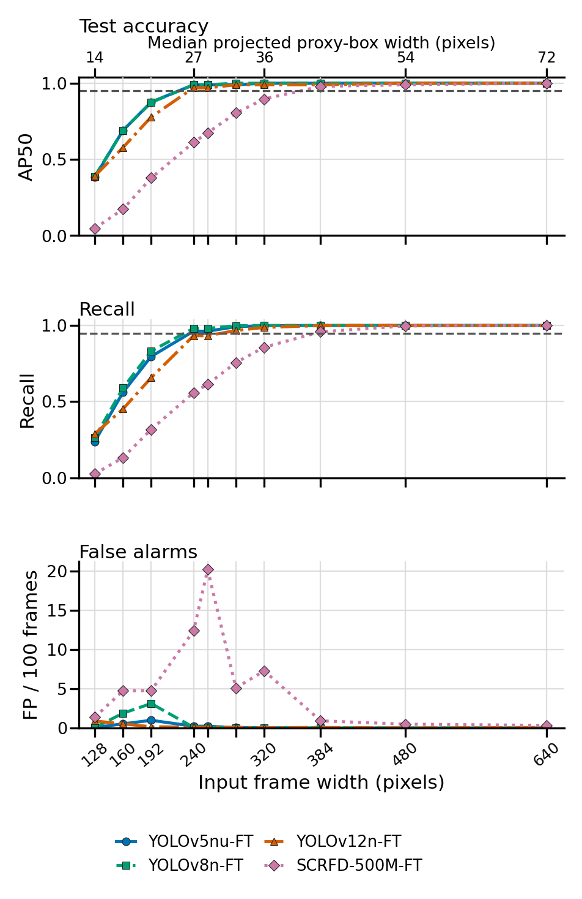
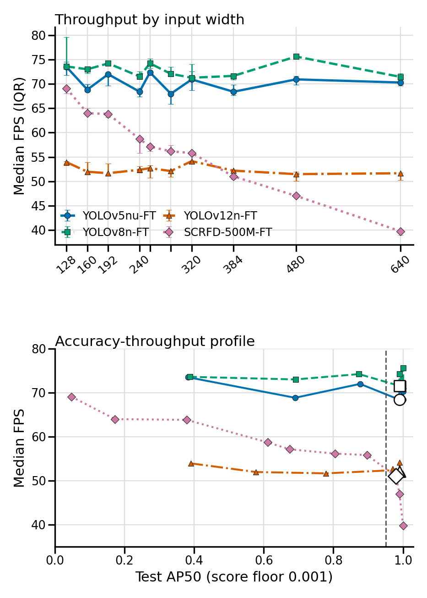
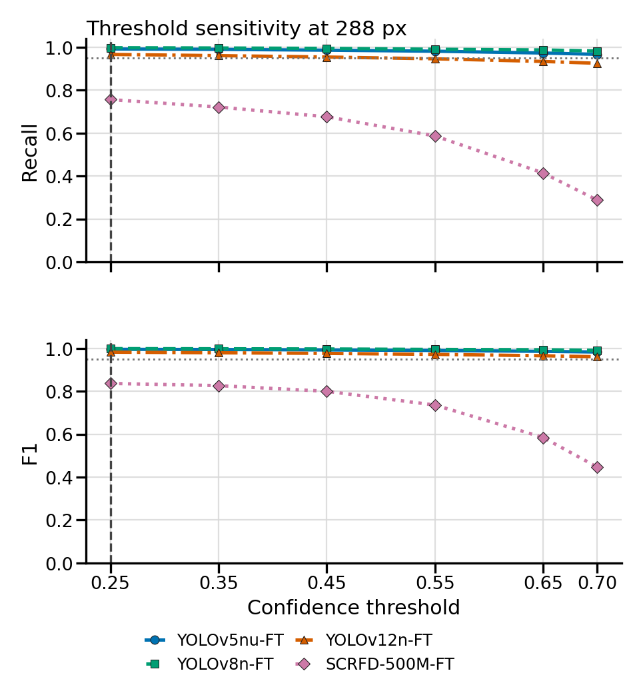
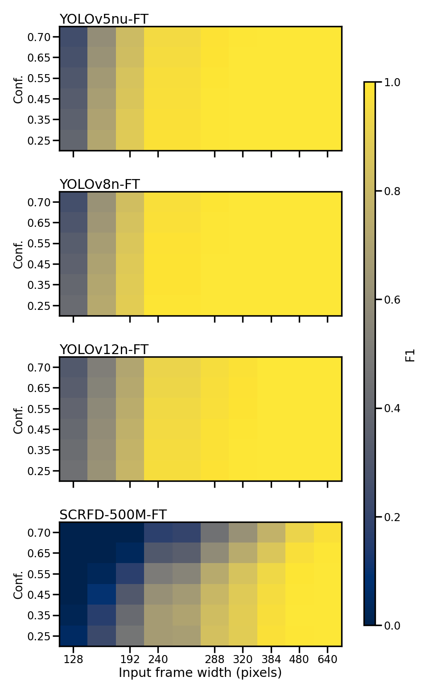

# Phát hiện khuôn mặt ở độ phân giải tối thiểu cho giám sát thời gian thực: Benchmark YOLO và SCRFD

| Vu Hai Minh / Khoa Trí tuệ Nhân tạo / Đại học FPT / Hà Nội, Việt Nam / vhaiminh.2k5@gmail.com | Cao Van Mai / Khoa Trí tuệ Nhân tạo / Đại học FPT / Hà Nội, Việt Nam / maicv2@fe.edu.vn |
| --- | --- |

**Tóm tắt—**Nghiên cứu này xây dựng một benchmark hướng đến triển khai để lựa chọn độ phân giải đầu vào cho bộ phát hiện khuôn mặt theo ngân sách độ chính xác và thông lượng đã xác định. Bốn mô hình đã fine-tune (YOLOv5nu, YOLOv8n, YOLOv12n và SCRFD-500M) được đánh giá trên video ChokePoint Portal 1 trong nhà, góc chính diện, với các tập chia tách theo chuỗi: 4.900 khung hình huấn luyện, 1.135 khung hình phát triển và 5.676 khung hình kiểm thử. Phép quét kiểm thử gồm mười độ rộng đầu vào (640–128 pixel) và sáu ngưỡng tin cậy. Quy tắc chỉ dùng tập phát triển chọn YOLOv8n-FT ở độ rộng 288 pixel; trên tập kiểm thử đã khóa, cấu hình này đạt AP50 1.000, recall 0.998 và thông lượng trung vị 72.1 khung hình/giây trên GPU NVIDIA GeForce RTX 3050 Laptop. Với ngưỡng AP50 và recall đặt trước là 0.95, độ rộng nhỏ nhất quan sát được trong phép quét kiểm thử là 240 pixel cho YOLOv5nu-FT và YOLOv8n-FT, 288 pixel cho YOLOv12n-FT và 384 pixel cho SCRFD-500M-FT. Các hồ sơ này cho thấy mức giảm độ phân giải nào vẫn giữ được độ khớp với nhãn đại diện và lợi ích tốc độ phụ thuộc vào mô hình ra sao. Benchmark hỗ trợ sàng lọc mô hình và độ phân giải cho bối cảnh giám sát này; nhãn sử dụng là các hộp suy ra từ mốc mắt, và nghiên cứu không đo độ chính xác nhận dạng hay hiệu năng trên phần cứng khác.

**Từ khóa—**phát hiện khuôn mặt, video giám sát, thay đổi độ phân giải, thông lượng, điểm vận hành, YOLO, SCRFD.

## I. GIỚI THIỆU

Trong các pipeline giám sát, mỗi khung hình thường được đưa qua bước phát hiện trước khi căn chỉnh khuôn mặt và nhận dạng danh tính. Giảm độ phân giải đầu vào có thể giảm khối lượng xử lý của bộ phát hiện, nhưng đồng thời làm mất chi tiết không gian của những khuôn mặt vốn đã nhỏ. Vì vậy, câu hỏi hữu ích khi triển khai không phải là bộ phát hiện nào đạt điểm cao nhất ở một độ phân giải, mà là tổ hợp mô hình, độ phân giải và ngưỡng tin cậy nào đáp ứng yêu cầu chất lượng phát hiện trong giới hạn xử lý sẵn có.

Bài báo cung cấp tài liệu tham khảo thực tiễn cho quyết định đó trên video ChokePoint Portal 1 trong nhà, góc chính diện. Bốn bộ phát hiện khuôn mặt được fine-tune trên cùng một cách chia tập theo chuỗi và được đo ở mười độ rộng đầu vào cùng sáu ngưỡng tin cậy. Chúng tôi báo cáo đồng thời chất lượng phát hiện và thông lượng được đo có đồng bộ, đưa ra một điểm vận hành đã khóa bằng tập phát triển, đồng thời tóm tắt độ rộng nhỏ nhất trong phép quét kiểm thử đạt ngưỡng AP50 và recall đặt trước. Các hồ sơ này giúp người triển khai sàng lọc cấu hình theo mức ưu tiên độ chính xác và tốc độ khung hình. Thông lượng chỉ được đo trên một GPU laptop cụ thể; các điểm số sử dụng hộp đại diện được suy ra minh bạch từ mốc mắt.

Bài toán triển khai có hai loại chi phí liên quan. Khuôn mặt bị bỏ sót sẽ không được cắt ảnh để căn chỉnh hoặc chuyển sang nhận dạng danh tính; ngược lại, phát hiện nhầm có thể làm phát sinh xử lý cho một vùng ảnh không phải khuôn mặt. Vì vậy, độ rộng ảnh và ngưỡng confidence ảnh hưởng đồng thời đến chất lượng định vị và số lượng ảnh cắt đưa xuống các bước sau. Benchmark này định lượng độ chính xác và thông lượng ở cấp bộ phát hiện để dự án có cơ sở chọn cấu hình ban đầu theo mức bỏ sót chấp nhận được và tốc độ khung hình mục tiêu; nghiên cứu không khẳng định riêng bộ phát hiện sẽ quyết định hiệu năng nhận dạng đầu cuối.

## II. CÔNG TRÌNH LIÊN QUAN

Phát hiện khuôn mặt thời gian thực từ lâu đã phải cân bằng giữa chất lượng định vị và chi phí tính toán. Viola và Jones sử dụng cascade để loại nhanh phần lớn cửa sổ ảnh [1]; các bộ phát hiện một giai đoạn hiện đại như YOLO dự đoán định vị và phân lớp trong một lượt truyền tiến [3]. Các checkpoint YOLOv5 và YOLOv8 được dùng ở đây là những triển khai Ultralytics đã được tài liệu hóa [6], [7], [10], trong khi YOLOv12 áp dụng thiết kế tập trung vào attention [8]. Đo các họ mô hình này ở nhiều độ rộng đầu vào giúp thể hiện sự đánh đổi tốc độ–chất lượng trong cùng một giao thức triển khai.

Phân tích khuôn mặt đặc biệt nhạy với chi tiết không gian khi khuôn mặt chỉ chiếm một vùng nhỏ trong khung hình giám sát. Các nghiên cứu trước về khuôn mặt độ phân giải thấp ghi nhận thách thức này trong ảnh không lý tưởng [2]. SCRFD là một lựa chọn chuyên biệt cho khuôn mặt, được thiết kế để phân bổ lại mẫu và tính toán nhằm đạt sự đánh đổi giữa hiệu quả và độ chính xác [9]. Trong nghiên cứu này, SCRFD được fine-tune trên cùng các tập huấn luyện và phát triển ChokePoint như YOLO. Vì vậy, phép so sánh mô tả hồ sơ của các bộ phát hiện đã điều chỉnh trong cấu hình được đo; không nên diễn giải thành xếp hạng chỉ dựa trên kiến trúc giữa các checkpoint tiền huấn luyện ban đầu.

ChokePoint cung cấp các chuỗi camera tại cổng và mốc mắt được gán nhãn thủ công thay vì hình chữ nhật khuôn mặt gốc [4], [5]. Nghiên cứu này sử dụng ảnh toàn khung hình và một quy tắc cố định để chuyển mốc mắt thành hộp phát hiện có thể tái lập, sau đó tách riêng các chuỗi hoàn chỉnh để kiểm thử. Giao thức tập trung phân tích lựa chọn độ phân giải thực tế, đồng thời nêu rõ quy ước tạo hộp mục tiêu.

## III. TẬP DỮ LIỆU VÀ QUY ƯỚC NHÃN

### A. Tập dữ liệu và cách chia theo chuỗi

Nguồn dữ liệu là tập con ảnh toàn khung hình 800×600 của Portal 1 trong nhà, góc chính diện thuộc ChokePoint. Các chuỗi nguồn hoàn chỉnh, thay vì khung hình được lấy ngẫu nhiên, được dùng để chia tập: ba chuỗi huấn luyện, một chuỗi phát triển và bốn chuỗi kiểm thử đã khóa. Không có chuỗi, cặp dữ liệu/khung hình hoặc cặp khung hình liền kề nào xuất hiện ở nhiều tập. Phiên S2 và camera C2 xuất hiện trong cả tập huấn luyện lẫn phát triển; camera C1 xuất hiện trong tập huấn luyện và kiểm thử, nhưng chuỗi nguồn và khung hình vẫn tách biệt. Cách chia này không khẳng định các danh tính trong tập đã được tách biệt.

**Bảng I. Phân hoạch dữ liệu theo chuỗi.**

| Tập | Chuỗi | Số khung hình |
| --- | --- | ---: |
| Huấn luyện | P1E_S1_C1 | 1,382 |
| Huấn luyện | P1L_S1_C1 | 1,799 |
| Huấn luyện | P1L_S2_C2 | 1,719 |
| Phát triển | P1E_S2_C2 | 1,135 |
| Kiểm thử | P1E_S3_C3 | 929 |
| Kiểm thử | P1E_S4_C1 | 1,531 |
| Kiểm thử | P1L_S3_C3 | 1,205 |
| Kiểm thử | P1L_S4_C1 | 2,011 |

Cách chia gồm 4.900 khung hình huấn luyện, 1.135 khung hình phát triển và 5.676 khung hình kiểm thử (tổng cộng 11.711). Tập phát triển được dùng để chọn mô hình và độ rộng vận hành; dữ liệu kiểm thử không được dùng để khớp mô hình, chọn checkpoint hay đưa ra lựa chọn đó. Sau đó, phép quét kiểm thử được báo cáo mô tả cho cả bốn mô hình và mọi độ rộng. Các số lượng này mô tả những mẫu toàn khung hình có nhãn trong manifest đã tạo, không đại diện cho mọi khung hình hay danh tính trong ChokePoint.

### B. Hộp mục tiêu và phạm vi nhãn

ChokePoint cung cấp mốc mắt được gán nhãn thủ công, không cung cấp hình chữ nhật khuôn mặt. Với khoảng cách giữa hai mắt là d và trung điểm hai mắt là (cx, cy), mỗi hộp tham chiếu được xác định như sau: x1=cx−1.4d, x2=cx+1.4d, y1=cy−1.2d và y2=cy+2.4d; sau đó tọa độ được cắt theo biên khung hình 800×600. Cùng một quy tắc hình học được áp dụng cho huấn luyện, phát triển và kiểm thử. Đây là các hộp đại diện cố định, không phải đường biên mặt gốc hay hộp khuôn mặt do người vẽ. AP50, precision, recall và F1 đo mức khớp theo quy ước này; quy tắc giúp benchmark có thể tái lập nhưng kết quả vẫn phụ thuộc hình học của hộp và không thể xem là độ chính xác so với nhãn người gán.

Một tệp hộp tham chiếu riêng do người dùng chỉ định bao phủ 240 khung hình kiểm thử, được cân bằng theo bốn chuỗi kiểm thử và ba nhóm khoảng cách giữa hai mắt. Tệp này chỉ được báo cáo như một phép so sánh mức khớp hộp bổ sung, không được dùng để chọn mô hình, độ phân giải hay ngưỡng.

Tọa độ của 240 hộp tham chiếu trùng khớp chính xác với tệp đề xuất đi kèm của InsightFace. Vì vậy, tập con này không cung cấp xác thực độc lập bằng nhãn người gán cho các đề xuất đó; cũng không có dữ liệu về độ nhất trí giữa người gán nhãn thứ hai hay bước phân xử. Bài báo báo cáo kết quả như một phép so sánh độ khớp bổ sung và giữ định nghĩa metric của phép quét chính gắn với các hộp đại diện suy ra từ mốc mắt. Tập này không được xem là một ground truth thứ hai hoặc bằng chứng cho thấy cách tạo hộp đại diện không thiên lệch.

## IV. THIẾT LẬP THỰC NGHIỆM

### A. Bộ phát hiện và fine-tune

Các bộ phát hiện được so sánh gồm YOLOv5nu, YOLOv8n và YOLOv12n khởi tạo từ trọng số nano của Ultralytics, cùng SCRFD-500M khởi tạo từ model zoo của InsightFace [9], [10]. Cả bốn mô hình sử dụng cùng 4.900 mẫu huấn luyện và 1.135 mẫu phát triển. Các mô hình YOLO được huấn luyện 20 epoch với độ rộng ảnh 640 pixel, batch size 8, seed 391, sử dụng Ultralytics 8.4.54 và cấu hình tự chọn optimizer đã được ghi nhận. SCRFD được huấn luyện 20 epoch, batch size 2, seed 391, theo recipe MMDetection đã ghi nhận (SGD, learning rate 0.0025). Recipe optimizer và augmentation khác nhau theo framework; cách chia dữ liệu và tập dùng để chọn mô hình là như nhau.

Phiên bản mã SCRFD, bản vá tương thích Windows, hash checkpoint và nguồn gốc quá trình huấn luyện được ghi trong các artifact chạy. Môi trường đo sử dụng PyTorch 2.1.2 với CUDA 12.1, Ultralytics 8.4.54, MMCV 1.7.2, MMDetection 2.7.0 và OpenCV 4.11.0. Mỗi bộ phát hiện dùng phép resize/letterbox theo framework gốc, giữ tỷ lệ khung hình và áp dụng độ rộng đầu vào tối đa chung.

### B. Metric và giao thức đo

Tỷ lệ khung hình được giữ nguyên ở các độ rộng đầu vào 640, 480, 384, 320, 288, 256, 240, 192, 160 và 128 pixel. Các ngưỡng tin cậy là 0.25, 0.35, 0.45, 0.55, 0.65 và 0.70; ghép cặp và non-maximum suppression đều dùng IoU 0.50. AP50 được tính từ các phát hiện có confidence trên ngưỡng sàn 0.001, với precision nội suy 101 điểm. Cần phân biệt hai loại số liệu: AP50 tổng hợp các phát hiện được xếp hạng từ ngưỡng sàn; còn precision, recall và F1 tại một confidence nhất định mô tả điểm vận hành cụ thể. Ngưỡng IoU 0.50 được chọn vì mục tiêu là các hộp đại diện theo quy ước hình học cố định; ngưỡng chồng lấp nghiêm ngặt hơn sẽ khiến điểm số nhạy với hình dạng hộp đại diện hơn là khác biệt giữa các bộ phát hiện. Ở mỗi ngưỡng tin cậy được liệt kê, dự đoán được ghép với một hộp đại diện chưa ghép trong cùng khung hình; các phát hiện không ghép và hộp bị bỏ sót lần lượt đóng góp vào false positive và false negative. Quy tắc đã xác định trước trên tập phát triển yêu cầu AP50≥0.95 và recall≥0.95 tại confidence 0.25, sau đó chọn độ rộng nhỏ nhất thỏa điều kiện. Nếu hòa, thứ tự phân định là AP50 phát triển cao hơn, recall cao hơn, rồi đến thứ tự mô hình cố định. Kết quả kiểm thử không làm thay đổi lựa chọn đó.

Thông lượng được đo trên mẫu cố định gồm 600 khung hình kiểm thử (150 khung hình cho mỗi chuỗi kiểm thử), 50 lượt khởi động và năm lượt đo đầy đủ, với GPU được đồng bộ quanh mỗi lượt đo. Vùng tính thời gian bao gồm đọc ảnh, tiền xử lý và thay đổi kích thước của framework, suy luận bộ phát hiện và hậu xử lý của mô hình; không tính thời gian nạp mô hình và tính metric. Thông lượng trung vị theo khung hình/giây và khoảng tứ phân vị được báo cáo cho GPU NVIDIA GeForce RTX 3050 Laptop có bộ nhớ 4 GB. Đây là thông lượng của bộ phát hiện, không phải độ trễ nhận dạng đầu cuối. Log chạy không ghi CPU, RAM hệ thống, phiên bản hệ điều hành hoặc driver CUDA và không có phép đo chỉ dùng CPU; vì vậy FPS là số liệu tham khảo cho đường xử lý phần mềm/GPU này, không phải hệ số quy đổi sang máy khác.

## V. KẾT QUẢ

### A. Mốc tham chiếu ở độ phân giải đầy đủ

**Bảng II. Kết quả kiểm thử ở độ rộng 640 pixel. AP50 dùng ngưỡng sàn score 0.001; recall dùng confidence 0.25.**

| Mô hình | AP50 | Recall | FPS |
| --- | ---: | ---: | ---: |
| YOLOv5nu-FT | 1.000 | 1.000 | 70.3 |
| YOLOv8n-FT | 1.000 | 0.999 | 71.4 |
| YOLOv12n-FT | 1.000 | 1.000 | 51.7 |
| SCRFD-500M-FT | 1.000 | 1.000 | 39.7 |

Ở độ rộng 640 pixel, cả bốn bộ phát hiện đã fine-tune đều đạt AP50 1.000 và recall từ 0.999 trở lên khi so với hộp đại diện. Thông lượng nằm trong khoảng từ 39.7 khung hình/giây của SCRFD-500M-FT đến 71.4 khung hình/giây của YOLOv8n-FT. Các điểm số gần mức tối đa khiến độ phân giải đầy đủ trở thành mốc tham chiếu hữu ích nhưng không phân biệt được các mô hình; hồ sơ vận hành của chúng khác biệt rõ hơn khi giảm độ phân giải.

### B. Hồ sơ độ phân giải, confidence và thông lượng

Quy tắc chỉ dùng tập phát triển đã chọn YOLOv8n-FT ở độ phân giải 288×216 pixel và confidence 0.25 (AP50 phát triển 0.9901; recall 0.9630). Trên tập kiểm thử đã khóa, cấu hình này đạt AP50 1.000, precision 1.000, recall 0.998, F1 0.999 và thông lượng trung vị 72.1 khung hình/giây (IQR 72.0–73.5). Với luồng 30 khung hình/giây, con số này tương đương thông lượng ở tầng bộ phát hiện gấp 2.4 lần trên GPU đã đo; với 60 khung hình/giây là gấp 1.2 lần, trước khi tính đến nhận dạng phía sau hoặc chi phí của nhiều luồng.

Hình 1 kết hợp AP50, recall và số false positive trên mỗi 100 khung hình; trục trên quy đổi độ rộng đầu vào thành độ rộng trung vị của hộp đại diện sau phép thu nhỏ (90.0 pixel khi khung gốc rộng 800 pixel). YOLOv5nu-FT và YOLOv8n-FT duy trì recall trên 0.95 đến độ rộng 240 pixel, YOLOv12n-FT đến 288 pixel, còn SCRFD-500M-FT đến 384 pixel. Ở 320 pixel, SCRFD có recall 0.857 và 7.28 false positive trên 100 khung hình; ở 384 pixel, recall đạt 0.958 và false positive giảm còn 0.92. Hình 2 khôi phục góc nhìn đánh đổi giữa độ chính xác và thông lượng; marker rỗng chỉ độ rộng nhỏ nhất mỗi mô hình vượt cả hai ngưỡng đặt trước. Tốc độ YOLO ít thay đổi khi giảm kích thước, còn SCRFD tăng tốc đồng thời độ chính xác giảm. Hình 3 tách riêng ảnh hưởng của confidence ở 288 pixel; Hình 4 thể hiện độ nhạy F1 theo toàn bộ tổ hợp độ phân giải và confidence cho cả bốn bộ phát hiện. Hai chỉ số recall và false positive thể hiện bổ sung xu hướng bỏ sót và báo động giả theo kích thước đầu vào.

**Hình 1.** AP50, recall và false positive trên mỗi 100 khung hình theo độ rộng đầu vào. Trục trên biểu diễn độ rộng trung vị của hộp đại diện sau khi thu nhỏ. AP50 dùng ngưỡng sàn score 0.001; recall và false positive dùng confidence 0.25. Đường nét đứt đánh dấu ngưỡng AP50 và recall 0.95. Marker và kiểu nét khác nhau giúp phân biệt mô hình khi in trắng đen.

**Hình 2.** Thông lượng trung vị theo độ rộng đầu vào (IQR qua năm lượt đo) và hồ sơ đánh đổi AP50–thông lượng. Marker rỗng đánh dấu độ rộng nhỏ nhất vượt cả ngưỡng AP50 và recall; hình dạng marker và kiểu nét phân biệt mô hình khi in trắng đen.

**Hình 3.** Recall và F1 trên tập kiểm thử theo ngưỡng confidence ở độ rộng 288 pixel. Hình dạng marker và kiểu nét phân biệt mô hình; đường dẫn nét đứt đánh dấu confidence 0.25 và điểm số 0.95.

**Hình 4.** F1 trên tập kiểm thử theo mười độ rộng đầu vào và sáu ngưỡng confidence cho từng bộ phát hiện đã fine-tune. Tên mô hình được ghi trên từng panel; thang độ sáng tuần tự vẫn đọc được khi in trắng đen.

**Bảng V.** Độ nhạy theo confidence của YOLOv8n-FT ở 288×216 pixel. AP50 giữ ở mức 0.999965 (làm tròn thành 1.000); cả sáu ngưỡng đều không có false positive.

| Confidence | Precision | Recall | F1 | False negative |
| --- | ---: | ---: | ---: | ---: |
| 0.25 | 1.000 | 0.998 | 0.999 | 9 |
| 0.35 | 1.000 | 0.997 | 0.999 | 17 |
| 0.45 | 1.000 | 0.995 | 0.998 | 27 |
| 0.55 | 1.000 | 0.991 | 0.996 | 50 |
| 0.65 | 1.000 | 0.988 | 0.994 | 68 |
| 0.70 | 1.000 | 0.983 | 0.991 | 97 |

Ở độ rộng đã chọn, tăng confidence từ 0.25 lên 0.70 không giảm thêm false positive vì không ghi nhận false positive ở cả hai ngưỡng, nhưng làm số hộp đại diện bị bỏ sót tăng từ 9 lên 97. Vì vậy, ngưỡng thấp phù hợp hơn khi bỏ sót khuôn mặt là lỗi có chi phí cao. Dự án coi trọng giảm cảnh báo nhầm hơn nên xác định đánh đổi này bằng dữ liệu phát triển riêng, thay vì xem 0.25 là ngưỡng phù hợp cho mọi trường hợp.

### C. So sánh bổ sung trên 240 khung hình

**Bảng III. Mức độ khớp với tệp tham chiếu 240 khung hình do người dùng chỉ định, ở độ rộng 288 pixel. AP50 dùng confidence sàn 0.001; precision, recall và F1 dùng 0.25.**

| Mô hình | AP50 | Precision | Recall | F1 |
| --- | ---: | ---: | ---: | ---: |
| YOLOv5nu-FT | 0.965 | 0.983 | 0.967 | 0.975 |
| YOLOv8n-FT | 0.944 | 0.958 | 0.954 | 0.956 |
| YOLOv12n-FT | 0.948 | 0.983 | 0.942 | 0.962 |
| SCRFD-500M-FT | 0.286 | 0.443 | 0.371 | 0.404 |

Ở 288 pixel, YOLOv5nu-FT đạt AP50 0.965 và recall 0.967 khi so với tệp tham chiếu 240 khung hình; các giá trị tương ứng của YOLOv8n-FT là 0.944 và 0.954, YOLOv12n-FT là 0.948 và 0.942, còn SCRFD-500M-FT là 0.286 và 0.371. IoU trung vị giữa hộp tham chiếu và hộp suy ra từ mốc mắt là 0.625 (IQR 0.593–0.654), với 239/240 cặp đạt từ 0.50 trở lên. Vì tọa độ của hộp tham chiếu trùng khớp chính xác với đề xuất InsightFace, đây là kết quả so sánh mức khớp giữa các hộp, không phải bằng chứng độc lập về độ chính xác so với hộp khuôn mặt do người gán nhãn vẽ.

### D. Miền vận hành kiểm thử theo từng mô hình

**Bảng IV. Độ rộng nhỏ nhất trong phép quét kiểm thử đạt ngưỡng AP50 và recall đã đặt ở confidence 0.25.**

| Mô hình | Độ rộng nhỏ nhất | AP50 | Recall | FPS |
| --- | ---: | ---: | ---: | ---: |
| YOLOv5nu-FT | 240 | 0.989 | 0.962 | 68.4 |
| YOLOv8n-FT | 240 | 0.990 | 0.981 | 71.5 |
| YOLOv12n-FT | 288 | 0.990 | 0.967 | 52.1 |
| SCRFD-500M-FT | 384 | 0.980 | 0.958 | 51.0 |

Các giá trị ngưỡng được đặt trước khi đánh giá tập kiểm thử, nhưng độ rộng trong Bảng IV là các mức nhỏ nhất mô tả từ phép quét kiểm thử đã hoàn tất. Chúng không thay thế lựa chọn YOLOv8n-FT ở 288 pixel đã khóa bằng tập phát triển. Các độ rộng nhỏ hơn cũng không bảo đảm thông lượng YOLO tăng: ở độ rộng nhỏ nhất, YOLOv5nu và YOLOv8n đạt 68.4 và 71.5 khung hình/giây, so với 70.3 và 71.4 khung hình/giây ở 640 pixel. SCRFD đạt 51.0 khung hình/giây tại độ rộng tối thiểu 384 pixel, so với 39.7 khung hình/giây ở 640 pixel; ở 128 pixel, thông lượng lên 69.1 nhưng recall chỉ còn 0.026. Bảng cung cấp hồ sơ tham chiếu có thể so sánh để sàng lọc bộ phát hiện; khi triển khai mới, điểm vận hành nên được chọn bằng dữ liệu phát triển riêng, nhất là khi camera, kích thước khuôn mặt hoặc phần cứng khác nhau.

## VI. KHUYẾN NGHỊ TRIỂN KHAI

Kết quả hỗ trợ một số lựa chọn cụ thể cho bối cảnh Portal 1 đã đo. Làm cấu hình mặc định cân bằng, có thể dùng YOLOv8n-FT đã được chọn bằng tập phát triển ở 288 pixel và confidence 0.25: cấu hình đạt ngưỡng chất lượng đặt trước và đo được 72.1 khung hình/giây. Nếu ưu tiên duy trì chất lượng hơn giảm kích thước đầu vào, YOLOv5nu-FT và YOLOv8n-FT ở 320–640 pixel giữ điểm số gần mức tối đa, với thông lượng khoảng 68–76 khung hình/giây trên GPU này. Với triển khai dùng bộ phát hiện chuyên biệt SCRFD, 384 pixel là độ rộng thấp nhất quan sát được trên tập kiểm thử đạt cả hai ngưỡng; thông lượng 51.0 khung hình/giây thấp hơn các cấu hình YOLO trong phép đo này. Kết quả YOLOv5nu hoặc YOLOv8n ở 240 pixel là mốc tham khảo hữu ích ở độ rộng thấp, nhưng không được quy tắc chỉ dùng tập phát triển chọn. Độ rộng 192 pixel trở xuống là lựa chọn kém cho cả bốn mô hình vì recall giảm dưới 0.84. Khi tăng confidence của YOLOv8n-FT từ 0.25 lên 0.70 ở 288 pixel, precision vẫn là 1.000 trong khi recall giảm từ 0.998 xuống 0.983; ngưỡng thấp hơn phù hợp hơn khi cần hạn chế bỏ sót khuôn mặt.

Để lập danh sách cấu hình ban đầu cho một dự án, trước hết cần xác định tốc độ khung hình mục tiêu và mức bỏ sót chấp nhận được; tiếp theo chọn mô hình và độ rộng từ Bảng IV, rồi dùng phép quét confidence để chốt điểm cân bằng precision–recall. Camera cố định trong nhà có khuôn mặt nhỏ và chi phí bỏ sót cao có thể bắt đầu từ YOLOv8n-FT ở 288 pixel hoặc độ rộng lớn hơn. Hệ thống hạn chế tính toán có thể đánh giá các cấu hình YOLO 240 pixel trên clip phát triển của chính mình, nhưng không nên mặc định rằng giảm độ phân giải sẽ tăng tốc. Ứng dụng cần bộ phát hiện chuyên biệt khuôn mặt có thể dùng SCRFD 384 pixel làm mốc chất lượng đã đo. Đây là cấu hình khởi đầu cho giai đoạn chạy thử và hiệu chỉnh, không phải bảo đảm cho ống kính, góc camera, điều kiện chiếu sáng hoặc mật độ người khác.

## VII. THẢO LUẬN

Các phép đo cho thấy không có một độ phân giải tối ưu cho mọi bộ phát hiện. YOLOv5nu-FT và YOLOv8n-FT đạt ngưỡng recall 0.95 đến 240 pixel, trong khi thông lượng trung vị thay đổi rất ít từ 640 xuống 240 pixel (70.3 xuống 68.4 và 71.4 lên 71.5 khung hình/giây). Trên GPU này, giảm kích thước đầu vào của hai mô hình đó chưa tạo ra mức tăng tốc đo được ở tầng phát hiện. YOLOv12n-FT duy trì khoảng 52 khung hình/giây trong dải thử nghiệm nhưng recall giảm dưới ngưỡng tại 256 pixel. SCRFD tăng thông lượng khi đầu vào nhỏ hơn, nhưng ở 320 pixel recall là 0.857 và false positive đạt 7.28 trên 100 khung hình; tại 384 pixel, recall tăng lên 0.958 và false positive giảm xuống dưới một trên 100 khung hình. Bản đồ F1 cho thấy confidence và độ phân giải tác động kết hợp, còn đường cong ở 288 pixel giúp tách việc chọn confidence khỏi phép quét độ phân giải. Khi triển khai, nhóm dự án nên xác định mức bỏ sót chấp nhận được trước, rồi dùng hồ sơ độ rộng và confidence theo từng mô hình để sàng lọc cấu hình. Kết quả gợi ý bắt đầu thử YOLOv8n-FT ở khoảng 288 pixel và SCRFD ở 384 pixel, sau đó xác nhận bằng các clip phát triển tại chỗ. Các hồ sơ này mô tả tập kiểm thử Portal 1 và đường đo RTX 3050; chúng không thiết lập xếp hạng kiến trúc nói chung hay bảo đảm chuyển giao sang phần cứng, camera khác.

## VIII. GIỚI HẠN VÀ HƯỚNG TIẾP THEO

Phép quét độ chính xác đo mức khớp với hộp đại diện suy ra từ mốc mắt, không phải đường biên khuôn mặt do người gán nhãn vẽ. Tệp phụ 240 khung hình không độc lập với đề xuất InsightFace, và không có người gán nhãn thứ hai hay bước phân xử độc lập. Đánh giá chỉ bao phủ các chuỗi trong nhà, góc chính diện tại Portal 1, không bao gồm cảnh ngoài trời, portal khác, che khuất nặng hay các danh tính được tách biệt hoàn toàn. Thông lượng chỉ được đo trên một GPU RTX 3050 Laptop với phần mềm và pipeline tiền xử lý đã nêu; thông tin CPU, RAM, driver và phiên bản hệ điều hành chưa được lưu trong log, và nghiên cứu chưa đo thông lượng trên phần cứng khác. Nghiên cứu cũng không đo độ chính xác nhận dạng, tải khi có nhiều khuôn mặt hoặc độ trễ toàn pipeline. Nghiên cứu tiếp theo cần bổ sung kiểm toán hộp mặt được vẽ độc lập, đo trên nhiều camera và cấu hình phần cứng, đồng thời đánh giá độ trễ nhận dạng đầu cuối trước khi đưa ra bảo đảm cấp hệ thống.

## IX. KẾT LUẬN

Benchmark chia tách theo chuỗi này chuyển các phép quét độ phân giải, mô hình và confidence thành hồ sơ lựa chọn bộ phát hiện thực tiễn cho video ChokePoint Portal 1 trong nhà, góc chính diện. YOLOv8n-FT ở 288 pixel là lựa chọn cân bằng được khóa bằng tập phát triển trên GPU RTX 3050 Laptop đã đo; phép quét kiểm thử cho thấy YOLOv5nu và YOLOv8n giữ ngưỡng chất lượng đại diện 0.95 đến 240 pixel, YOLOv12n đến 288 pixel và SCRFD đến 384 pixel. Với các dự án kiểm soát ra vào, điểm danh và giám sát lối vào trong nhà, các hồ sơ này giúp sàng lọc model, kích thước đầu vào và ngưỡng confidence theo mức bỏ sót cùng ngân sách tính toán đã xác định. Tốc độ 72,1 khung hình/giây tương ứng năng lực ở tầng phát hiện bằng 2,4 lần luồng 30 fps hoặc 1,2 lần luồng 60 fps, trước chi phí nhận dạng và nhiều camera. Các cấu hình YOLO 240–288 pixel là ứng viên giảm kích thước khi hạn chế tính toán; dải 320–640 pixel giữ lại nhiều chi tiết ảnh hơn; SCRFD ở 384 pixel tạo mốc đối chiếu cho ứng dụng cần bộ phát hiện chuyên biệt khuôn mặt. Các hồ sơ đo được hỗ trợ ước lượng cấu hình ban đầu và ngân sách phần cứng tương tự, còn tác động đến nhận dạng và khả năng chuyển sang cảnh hay thiết bị khác cần được đánh giá khi tích hợp tại chỗ.

## Tài liệu tham khảo

[1] P. Viola and M. J. Jones, "Robust real-time face detection," Int. J. Comput. Vis., vol. 57, no. 2, pp. 137-154, 2004, doi: 10.1023/B:VISI.0000013087.49260.fb.

[2] P. Li, L. Prieto, D. Mery, and P. J. Flynn, "On low-resolution face recognition in the wild: Comparisons and new techniques," arXiv:1805.11529, 2018.

[3] J. Redmon, S. Divvala, R. Girshick, and A. Farhadi, "You Only Look Once: Unified, real-time object detection," in Proc. IEEE Conf. Computer Vision and Pattern Recognition (CVPR), 2016, pp. 779-788.

[4] Y. Wong, S. Chen, S. Mau, C. Sanderson, and B. C. Lovell, "Patch-based probabilistic image quality assessment for face selection and improved video-based face recognition," in Proc. IEEE Biometrics Workshop, Computer Vision and Pattern Recognition Workshops, 2011, pp. 81-88, doi: 10.1109/CVPRW.2011.5981881.

[5] Y. Wong, S. Chen, S. Mau, C. Sanderson, and B. C. Lovell, "ChokePoint Dataset," Zenodo, version v1, Jun. 22, 2017, doi: 10.5281/zenodo.815657.

[6] G. Jocher et al., "ultralytics/yolov5," GitHub repository and software release, 2020-2022.

[7] D. Reis, J. Kupec, J. Hong, and A. Daoudi, "Real-time flying object detection with YOLOv8," arXiv:2305.09972, 2023.

[8] Y. Tian, Q. Ye, and D. Doermann, "YOLOv12: Attention-centric real-time object detectors," in Advances in Neural Information Processing Systems, vol. 38, 2025, doi: 10.52202/085713-2627.

[9] J. Guo, J. Deng, A. Lattas, and S. Zafeiriou, "Sample and computation redistribution for efficient face detection," in Proc. Int. Conf. Learning Representations, 2022, doi: 10.48550/arXiv.2105.04714.

[10] Ultralytics, "Models supported by Ultralytics." [Online]. Available: https://docs.ultralytics.com/models. Accessed: Nov. 15, 2026.
